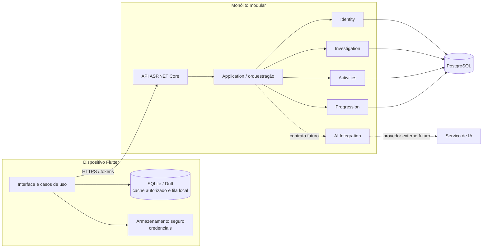
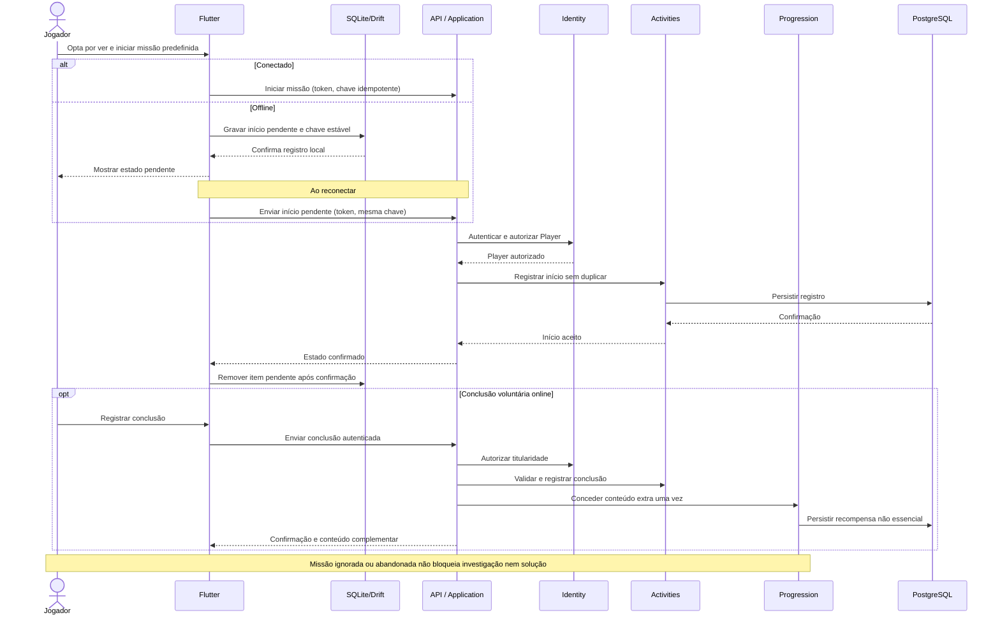

# ADR-001 — Arquitetura do MVP de Questigma

- **Status:** aceito
- **Data:** 17/11/2026
- **Fontes:** [visão do produto](../PRODUCT.md) e [issue #8](https://github.com/abigaildotnet/questigma/issues/8), decisões DEC-001 a DEC-006
- **Escopo:** decisões arquiteturais; implementação de código, esquema físico e infraestrutura ficam para tarefas posteriores.

## Contexto e critérios

Questigma é um jogo mobile de investigação de casos autorais. A solução, as pistas essenciais e os desbloqueios pertencem ao caso e devem ser alcançáveis apenas com ações dentro do jogo. Missões ligadas a atividades pessoais são voluntárias, concedem somente conteúdo complementar e não podem bloquear a conclusão. O MVP deve permanecer viável para uma desenvolvedora individual e funcionar com missões predefinidas mesmo sem IA.

As decisões abaixo estabelecem responsabilidades e limites, sem antecipar contratos HTTP, tabelas ou infraestrutura definitiva.

## DEC-001 — Estilo arquitetural

**Decisão.** Um monólito modular em ASP.NET Core, implantado inicialmente como uma API única e organizado por capacidades de negócio, com princípios de Clean Architecture. Regras de domínio ficam independentes de HTTP, EF Core, PostgreSQL e provedores externos. Interfaces são usadas nos limites em que melhoram isolamento e testes, sem abstrações genéricas por padrão.

**Justificativa.** Um processo único reduz custo de operação e mantém a arquitetura rastreável no MVP. Limites por capacidade permitem evoluir regras sem misturar investigação, atividades, progressão, identidade e IA.

**Alternativas e trade-offs.** Quatro projetos tradicionais por camada tornariam a separação explícita, com maior custo estrutural para o MVP. Um monólito sem limites modulares aceleraria o primeiro passo, mas facilitaria acoplamento. Microsserviços acrescentariam implantação e comunicação distribuída sem necessidade demonstrada. O monólito modular ainda exige disciplina para preservar seus limites; sua divisão deve ser revista quando houver evidência de requisitos novos.

### Limites dos módulos

| Componente ou módulo | Responsabilidade e autoridade | Limite de acesso |
| --- | --- | --- |
| Flutter | Interface, preferência de exibir missões, cache local e registro offline permitido. | Não decide verdade, desbloqueios, deduções, recompensas ou solução. |
| API HTTP / Application | Autentica e autoriza requisições; orquestra casos de uso e coordena transações entre módulos. | Não reimplementa invariantes de domínio. |
| Investigation | Catálogo e conteúdo canônico do caso; pré-condições de pistas, deduções, acusações e solução. | Não delega a verdade do caso à IA nem a atividades pessoais. |
| Activities | Modelos predefinidos e registros voluntários de missões pessoais. | Não concede pistas essenciais nem determina progressão obrigatória. |
| Progression | Estado narrativo do jogador, desbloqueios e recompensas complementares validados no servidor. | Consulta contratos de Investigation e Activities; não acessa livremente as tabelas alheias. |
| Identity | Criação do Player anônimo, emissão/renovação de credenciais e autorização por titularidade. | UUID de Player isolado não autentica. |
| AI Integration (futuro) | Sugestão ou adaptação da apresentação de missões opcionais dentro de modelos e limites autorais. | Não cria evidências canônicas, não valida a solução e não controla progressão. |
| PostgreSQL | Persistência oficial do catálogo, conteúdo narrativo autorizado e progresso validado. | Acesso por repositórios/serviços dos módulos; sem compartilhamento irrestrito de tabelas. |
| SQLite/Drift | Cache de conteúdo já autorizado e registros locais de atividades permitidos. | Não é fonte de verdade do progresso narrativo nem armazena credenciais. |

## DEC-002 — Estratégia offline e autoridade do backend

**Decisão.** A experiência é *online-first* com suporte offline parcial. A API .NET é a fonte de verdade para progresso narrativo, pistas, deduções, acusações, desbloqueios, recompensas e solução. Online, o jogador consulta casos, investiga novas cenas, descobre pistas, registra deduções e envia acusações; a API valida e persiste as mudanças.

Offline, o Flutter pode mostrar conteúdo previamente autorizado e em cache, reler evidências e diálogos disponíveis e registrar localmente o **início** de uma atividade pessoal para envio posterior. Não descobre novas evidências, não registra novas deduções narrativas, não resolve o caso e não concede recompensa enquanto estiver desconectado. O primeiro acesso depende de conexão para criar a identidade anônima autenticada. Falha da IA não retira missões predefinidas.

**Justificativa e trade-off.** Centralizar as regras críticas em C# evita duplicar o motor narrativo em Dart e facilita futura restauração de progresso com conta. Em troca, parte da investigação requer conexão e o cliente precisa de cache e fila mínima. O cache só exibe conteúdo já autorizado para aquele Player; seu estado não se torna uma nova autoridade.

## DEC-003 — Persistência

**Decisão.** PostgreSQL no backend, acessado com EF Core/Npgsql; SQLite com Drift no Flutter. PostgreSQL guarda catálogo oficial, conteúdo narrativo autorizado e progresso validado do Player. SQLite/Drift guarda cenas, pistas e diálogos já autorizados para releitura e registros locais de início de atividades pessoais aguardando envio. Credenciais ficam no armazenamento seguro da plataforma, fora do Drift.

**Justificativa e trade-off.** PostgreSQL oferece integridade transacional e permite adquirir experiência com o banco escolhido. SQLite/Drift oferece cache relacional estruturado no dispositivo. Dois modelos implicam mapeamento e atualização de cache; por isso não se prevê sincronização geral no MVP. O cliente só aplica ao cache respostas autorizadas da API. A fila de atividades precisa de identificador estável por registro, reenvio idempotente e confirmação antes de remover o item local. Esquema, política de expiração/invalidação do cache e limites exatos dessa fila permanecem para detalhamento posterior.

## DEC-004 — Comunicação entre módulos

**Decisão.** Casos de uso em Application orquestram chamadas diretas por interfaces ou contratos explícitos dos módulos. Cada módulo mantém suas regras e expõe operações específicas; nenhum módulo lê ou altera indiscriminadamente as tabelas de outro. Contratos não devem formar dependências circulares ou cadeias profundas. Fluxos que gravam em mais de um módulo devem definir uma transação e uma chave de idempotência, especialmente para evitar concessão dupla de recompensa após reenvio.

**Justificativa e trade-off.** Chamadas diretas mantêm ordem, falha e rastreamento claros num único backend. Eventos internos de domínio reduziriam o acoplamento com notificadores, mas adicionariam despacho, ordem e tratamento de falhas aos fluxos principais. RabbitMQ exigiria infraestrutura, retentativas e observabilidade sem demanda atual. Eventos ou mensageria podem ser introduzidos para efeitos secundários quando surgir necessidade comprovada. Os contratos concretos e a fronteira transacional de cada caso de uso serão detalhados na implementação.

### Fluxo de uma missão pessoal

O diagrama distingue um início local pendente de um registro aceito pelo backend. A conclusão voluntária e a recompensa complementar passam pela API; o caso continua solucionável sem missão.

## DEC-005 — Identidade do jogador

**Decisão.** No primeiro acesso online, a API cria um Player anônimo e emite acesso temporário com renovação. O Flutter guarda credenciais no armazenamento seguro da plataforma, separado do cache SQLite. A API reconhece o Player pelo token, autoriza por titularidade e transporta credenciais somente por HTTPS. UUID sozinho não é credencial.

Tokens de renovação são aleatórios, armazenados como hash no servidor, rotacionados e sujeitos a expiração e revogação. O serviço também precisa de limitação de taxa e proteção contra criação abusiva de perfis. Isso evita cadastro obrigatório, mas adiciona ciclo de vida de credenciais. Uma conta futura poderá ser vinculada ao Player existente com prova de posse da sessão, preservando progresso remoto. Recuperação entre dispositivos não integra o MVP; perder dispositivo ou credenciais sem conta recuperável pode impedir o acesso ao progresso.

## DEC-006 — Estratégia de testes

**Decisão.** Usar xUnit para invariantes de domínio; xUnit com Testcontainers/PostgreSQL para integração; `flutter_test` para estados e fluxos do cliente; e verificações automáticas em PRs via GitHub Actions. A suíte prioriza riscos de negócio e consistência, não uma meta de 100% de cobertura.

| Nível | Verificações prioritárias |
| --- | --- |
| Domínio | Pré-condições para evidências, deduções e acusações; recompensa concedida uma vez; isolamento entre jogadores; missões opcionais sem desbloqueio essencial. |
| Integração | Autorização da identidade anônima, EF Core/PostgreSQL, contratos HTTP, transações e reenvio idempotente de atividade. |
| Flutter | Seleção de caso, loading/error, cache apenas de evidências autorizadas, leitura offline e estado de início de missão pendente. |
| Conteúdo | Validador de solvabilidade do grafo de dependências: detectar ciclos bloqueantes e garantir caminho da premissa à solução sem missões reais. |
| IA futura | Contratos de resposta, validação dos limites autorais, erros e fallback determinístico para missões predefinidas. |

O validador de conteúdo deve tratar pistas, deduções e desbloqueios como nós e pré-condições como arestas. Para cada caso, verifica alcançabilidade da solução com todas as missões reais omitidas e sinaliza dependências circulares que impeçam esse percurso. Isso protege o princípio do produto de uma investigação concluível dentro do jogo. Testcontainers e GitHub Actions consomem Docker e recursos de CI; a configuração da suíte fica para tarefas posteriores e deve ser enxuta.

## Pontos ainda abertos

- Definir esquema do cache Drift, invalidação de conteúdo e capacidade da fila offline.
- Definir limites concretos da sincronização de registros pessoais, inclusive o tratamento da conclusão se ocorrer sem conexão. Este ADR só autoriza explicitamente o início offline conforme DEC-002.
- Detalhar contratos entre módulos, fronteiras transacionais e políticas de expiração/renovação de credenciais durante a implementação.
- Revisar a modularidade e eventual mensageria quando requisitos reais justificarem a mudança.
